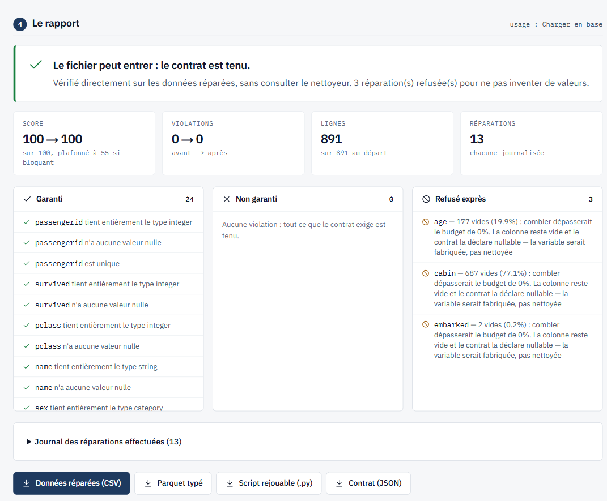
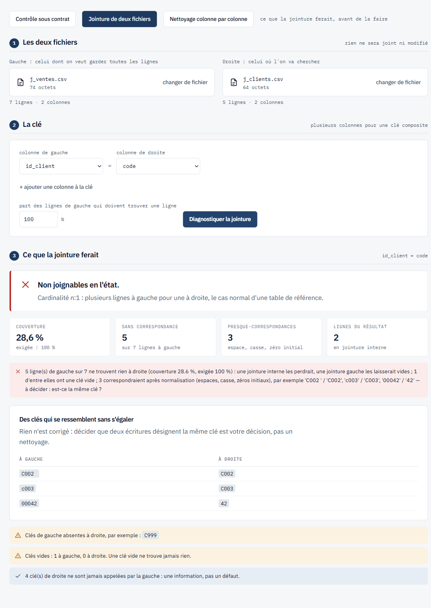

# Intelligent Data Cleaner

Le prétraitement d'un fichier tabulaire, en entier — **et ce qu'il refuse de
faire, dit en clair.**

Déposez un CSV ou un Excel. L'outil vous rend trois choses : les données
réparées, un **contrat** qui dit ce qu'elles garantissent désormais, et une
**chaîne de préparation** prête pour l'apprentissage. Chacune des trois porte
la liste de ce qu'elle n'a pas pu faire.

[](https://github.com/Yoh5/intelligent_data_cleaner/actions/workflows/tests.yml)


---

## La thèse, en un paragraphe

Un nettoyeur qui note lui-même son travail finit toujours par se donner une
bonne note. Celui-ci a commencé comme ça, et la mesure est dans le dépôt :
sur un fichier de 430 lignes, la boucle agentique a rendu **100/100** sur une
sortie où `inconnu` avait été imputé dans **247 lignes sur 400**, où `Rabat`
et `rabat` restaient deux modalités distinctes, où un tiers d'une colonne
numérique s'était posé sur sa médiane, et où toutes les colonnes sortaient en
texte.

Rien n'était faux dans la boucle. **L'objectif l'était** : elle optimisait la
liste de problèmes de son propre profileur, c'est-à-dire sa propre opinion.

La réponse n'a pas été d'ajouter des règles. Elle a été de changer ce qu'on
mesure, et de le faire mesurer par autre chose.

---

## Les trois choses que l'outil rend

### 1. Un contrat, vérifié indépendamment du nettoyeur

`POST /contract-clean/` — vous déclarez un **usage**, l'outil en déduit ce que
le fichier doit garantir, le répare dans cette direction, puis **vérifie** le
résultat sans jamais consulter le profileur.

| usage | imputation max | lignes perdues max | clé exigée |
|---|---|---|---|
| entraîner un modèle | 10 % | 5 % | non |
| charger en base | **0 %** | **0 %** | oui |
| alimenter un tableau de bord | 20 % | 10 % | non |
| joindre à une autre table | 5 % | **0 %** | oui |

Trois propriétés portent tout le reste, et elles sont délibérées :

- **La vérification ne consulte pas le nettoyeur.** `contract.py` ne mesure
  que le DataFrame. C'est ce qui permet au rapport de **contredire** la
  réparation, et c'est pourquoi l'inférence vit ailleurs (`contract_infer.py`)
  — la dépendance ne va que dans un sens.
- **Une violation bloquante plafonne le score à 55.** Sans ce plafond, un
  défaut fatal se noie sous une majorité de contrôles réussis : c'est
  exactement ainsi qu'un 100/100 arrive.
- **La perte d'information est dans l'objectif.** `lignes_perdues_max` et
  `imputation_max` font du sur-remplissage une **violation**, donc la
  réparation **refuse** au lieu de fabriquer. Le journal des refus est un
  livrable : il dit quelles garanties les données ne peuvent pas porter, et
  pourquoi.

### 1 bis. La **forme** d'une valeur, pas seulement son type

Un type dit ce qu'une valeur **est** ; une forme dit à quoi elle doit
**ressembler**. `999.1.2.3` est du texte parfaitement valide, et aucun contrôle
de type ne le refusera jamais. C'est le contrôle qui manquait, et c'est celui
qui compte sur des données de sécurité.

Huit formes connues — `ipv4`, `ipv6`, `mac`, `email`, `uuid`, `url`, `sha256`,
`md5` — plus n'importe quelle expression régulière, qui doit compiler à la
déclaration : une regex fautive refuserait tout, ce qui se lirait comme une
colonne entièrement invalide.

**Elle est détectée, pas seulement déclarable**, et sur **deux** mesures plutôt
qu'un seuil. À 75 % d'adresses IPv4, faut-il déclarer la forme ? La question
n'a pas de bonne réponse posée ainsi, parce qu'elle ignore ce que sont les
25 % restants :

- *trois quarts d'adresses, et le reste est deux jetons répétés* → c'est une
  colonne d'adresses avec des sentinelles, rien d'autre ne l'explique ;
- *trois quarts d'adresses, et le reste est deux cents chaînes différentes* →
  ce n'est pas une colonne d'adresses, c'en est une qui en contient parfois.

D'où une part minimale **et** un reste qui se compte sur les doigts, tous deux
cités dans la note pour qu'on puisse les contester.

Une valeur hors forme devient un **vide**, jamais une autre valeur — et ce vide
tombe sous le budget d'imputation comme les autres.

### 2. Une chaîne de préparation, ajustée après la séparation

`POST /prepare/` — vides, types, encodage, mise à l'échelle. Le prétraitement
complet, **sans la fuite qui le rendait malhonnête.**

Ce projet a longtemps refusé l'encodage et la mise à l'échelle, et la raison
était juste : **ajuster un transformateur sur le fichier entier fait fuiter
l'information du test dans l'entraînement.** Un `StandardScaler` ajusté avant
la séparation connaît la moyenne des lignes qu'il est censé n'avoir jamais
vues, et toute évaluation faite ensuite est optimiste d'une quantité qu'on ne
sait pas mesurer.

La raison n'a pas disparu. Ce qui a changé, c'est qu'**on ne transforme pas le
fichier : on rend la chaîne**, sous forme d'un script autonome où
`train_test_split` passe avant `fit`, et où il n'existe aucune option pour
faire l'inverse.

Un test l'établit en exécutant le script produit, en lisant la moyenne que le
`StandardScaler` a réellement apprise, et en la comparant à celle de
l'entraînement **et** à celle du fichier entier. Une assertion sur le texte du
script passerait sur du code qui fuit.

Et il écarte plutôt que de traiter au jugé, chaque fois avec sa raison :

| colonne écartée | raison |
|---|---|
| clé primaire | un identifiant n'explique rien, il désigne une ligne |
| 300 modalités | un one-hot produirait plus de colonnes qu'il n'en explique |
| colonne constante | variance nulle, et certains estimateurs la refusent |
| date | la dériver exige de savoir ce que le modèle doit apprendre |

### 3. Un script de nettoyage autonome

`POST /auto-clean/` puis `POST /execute/` — l'analyse, le choix d'une stratégie
par problème, et un `.py` qui tourne sans cette application.

> **Deux défauts corrigés le 15 octobre 2026**, et le second était fatal.
> `/auto-clean/` renvoyait 500 sur tout fichier comportant un problème. Et le
> script produit **jetait tout son nettoyage** : le gabarit ouvrait sur
> `df_clean = df.copy()`, les soixante-dix extraits de stratégie écrivaient
> sur `df`, et la fonction rendait `df_clean` — la copie prise *avant* la
> première étape. Le script tournait, journalisait « RESULTAT », annonçait
> « 8 → 8 lignes », et réécrivait les données d'origine sous le nom
> `cleaned_*.csv`. Aucune erreur, aucun avertissement.
>
> Rien ne l'avait vu parce que le seul test de bout en bout écrivait son étape
> à la main avec `df_clean` — le seul endroit du dépôt à employer ce nom. Son
> erreur correspondait à celle du gabarit, les deux s'annulaient, et le test
> restait vert au-dessus d'un produit qui ne nettoyait rien.

---

## Ce qui a été mesuré, et sur quoi

### Le corpus de pathologies — `backend/tests/corpus.py`

Vingt fichiers, **une pathologie chacun**, avec une attente et un enjeu
déclarés. Les fichiers réels trouvent ce à quoi on n'avait pas pensé ; le
corpus trouve ce à quoi on avait pensé, et dit **laquelle** a cassé.

Ce qu'il a trouvé à sa première exécution :

- **Les zéros initiaux étaient mangés.** `01000` devenait `1000`, et aucun
  contrôle de type ne pouvait le voir puisque la colonne tenait parfaitement
  son type déclaré. La cause était au chargement : pandas convertit avant que
  quoi que ce soit d'autre ne tourne. La passe lit désormais tout en texte et
  décide des types elle-même.
- **Un fichier sans ligne de données plantait en 500.** Il rend maintenant un
  400 et dit qu'un fichier vide est normal avant un premier chargement et un
  incident après — et que rien dans le fichier ne distingue les deux.
- **Les négatifs comptables `(1200)` passaient inaperçus.** Retirer les
  parenthèses transforme un débit en crédit.

### Le corpus public — `corpus-public/`

Cinq jeux réels, téléchargés et **non versionnés** (3,5 Mo, licences
différentes ; les URL sont dans `corpus-public/README.md`, le re-téléchargement
prend trente secondes). Les tests se sautent proprement si le dossier est vide.

- **`?` manquait à la liste des marqueurs de vide**, qui connaissait `???`.
  UCI Adult l'emploie sur 5,6 % de trois colonnes : 1 700 vides qui seraient
  passés pour des modalités.
- **Titanic valide le refus d'écrêter.** La passe signale un tarif de 512 £ et
  une fratrie de 8 comme hors de l'intervalle plausible. **Les deux sont
  vrais** : la famille Cardeza avait les billets les plus chers du navire, et
  les Sage voyageaient à onze. Un outil qui écrête par défaut détruirait les
  lignes les plus intéressantes du jeu de données le plus enseigné du domaine,
  en silence, en annonçant un succès.

### Les valeurs aberrantes : mesurées toujours, déclarées sur demande, jamais écrêtées en silence

Trois positions possibles, et le défaut est la seule qui ne fabrique rien.
L'inférence **signale toujours** combien de valeurs sortent d'un intervalle
robuste, avec des exemples. L'écrêtage et le vidage existent, sont explicites,
et obéissent au budget d'imputation — parce que ramener trois cents revenus au
plafond invente trois cents revenus identiques qui n'ont jamais existé.

La raison n'est pas la timidité : une valeur extrême est tantôt une faute de
frappe, tantôt la ligne la plus importante du fichier, et la colonne seule ne
permet pas de les distinguer.

### Performance

**1,8 Mo/s pour la passe entière** — 500 000 lignes / 21 Mo en 11,4 s (médiane
de cinq courses, écart-type 0,8 s), sensiblement linéaire.

`/contract-clean/` plafonne les dépôts à **25 Mo** et non aux 100 Mo des autres
routes : à 1,8 Mo/s, 100 Mo demandent près d'une minute, ce qu'aucune requête
HTTP ordinaire ne survit. Aller plus haut exige un traitement en arrière-plan
avec un identifiant de tâche, ce qui est un autre produit.

---

## Sécurité

`POST /execute/` lance un script Python **venu du client** — c'est voulu,
l'utilisateur peut relire et corriger ce qui a été produit. Deux barrières, et
la première est celle qui protège :

- **L'environnement du sous-processus est construit, pas hérité.** Avant ça,
  le script tournait avec l'`OPENAI_API_KEY` du serveur et sa sortie revenait
  à l'appelant : **trois lignes exfiltraient la clé.**
- `check_script()` refuse ce qui sort de la forme que le générateur produit —
  liste blanche d'imports, pas d'`eval`, pas de `__import__`. C'est de la
  défense en profondeur, **pas un bac à sable** : du Python arbitraire reste du
  Python arbitraire.

---

## L'interface

Une page, organisée autour de la question qu'on se pose avant un chargement :
**ce fichier peut-il entrer en base, et qu'a-t-on refusé d'inventer ?**
On dépose le fichier, on déclare l'usage (charger en base, joindre, entraîner
un modèle, alimenter un tableau de bord), on lit le contrat proposé et ses
arbitrages **avant** que rien ne change, puis on lance la passe.


Le rapport sépare trois choses que les nettoyeurs mélangent : ce qui est
**garanti** (vérifié sur les données), ce qui **ne l'est pas** (les violations),
et ce qui a été **refusé exprès** (les réparations qui auraient inventé des
valeurs). Le refus est en ambre, pas en rouge : ce n'est pas une erreur, c'est
une décision.



Un deuxième onglet répond à la question d'avant jointure : **ces deux fichiers
sont-ils joignables ?** On dépose les deux, on désigne la clé, et on lit ce que
la jointure ferait — couverture, lignes sans correspondance, clés qui se
ressemblent sans s'égaler — sans qu'elle soit faite ni que rien soit corrigé.



Le nettoyage colonne par colonne, avec choix de stratégie et script rejouable,
reste disponible dans un troisième onglet.

---

## En ligne de commande : la barrière dans une chaîne de chargement

```bash
cd backend
python -m app.cli check clients.csv --usage base              # verdict lisible
python -m app.cli check clients.csv --usage base --json       # verdict pour une machine
python -m app.cli check clients.csv --sortie out/             # + données réparées, Parquet, contrat
python -m app.cli check livraison.csv --contrat out/clients_contrat.json
```

Tout tient dans le **code de sortie**, parce que c'est lui qu'une chaîne lit :

| code | sens |
|---|---|
| 0 | le contrat est tenu : le fichier peut entrer |
| 1 | le contrat n'est pas tenu : il ne doit pas entrer tel quel |
| 2 | indécidable : fichier absent ou illisible, usage inconnu, contrat invalide |

1 et 2 sont distincts exprès : une panne qui sortirait 1 passerait pour un
verdict. La dernière forme est l'usage le plus utile : le contrat écrit pour
un premier fichier sert de barrière à **toutes les livraisons suivantes**.
Rien n'est écrit sur le disque sans `--sortie`.

Mesuré sur le corpus public, usage « charger en base » : Titanic, Air Travel et
OWID passent (0) ; UCI Adult et US Cities sont refusés (1), aucun des deux
n'ayant de colonne qui identifie une ligne.

### Avant une jointure : ces deux fichiers sont-ils joignables ?

```bash
python -m app.cli join ventes.csv clients.csv --sur id_client
python -m app.cli join ventes.csv clients.csv --sur "Id Client=code"     # noms différents
python -m app.cli join a.csv b.csv --sur pays --sur code                  # clé composite
python -m app.cli join a.csv b.csv --sur id --couverture-min 0.95 --json
```

Une jointure ne plante jamais : elle rend **moins** de lignes (clés orphelines)
ou **plus** (clé répétée des deux côtés), sans rien dire. La commande mesure ce
que la jointure ferait, sans la faire : cardinalité réelle, couverture, nombre
de lignes du résultat. Mêmes codes de sortie : 0 joignable, 1 non, 2 indécidable.

Elle nomme surtout les **presque-correspondances**, le cas qui coûte des
heures : des clés qui se ressemblent sans s'égaler (espace, casse, zéro initial
mangé par un tableur). Elle ne les répare pas — décider que `00042` et `42`
sont le même client est une décision, pas un nettoyage.

Mesuré sur deux jeux réels : joindre Titanic à UCI Adult sur `sex` donne
**0 ligne**, parce que l'un écrit `male` et l'autre `Male`. La commande le dit
avant : 891 orphelines, 891 rattrapables, `'male' / 'Male'`. Et joindre Titanic
à lui-même sur `pclass` rendrait 321 593 lignes pour 891. Le nombre de lignes
annoncé est vérifié contre une vraie jointure pandas.

---

## Lancer

```bash
# Backend
cd backend
python -m venv venv && venv\Scripts\activate
pip install -r requirements.txt
uvicorn app.main:app --reload          # http://localhost:8000/docs

# Frontend
cd frontend && npm install && npm run dev   # http://localhost:3000

# Tests — 221 (dont 1 sauté), sans réseau et sans clé
cd backend && python -m pytest tests/ -q
```

La boucle agentique et le conseiller LLM tournent **100 % hors ligne** : sans
`OPENAI_API_KEY`, le conseiller se replie sur les règles et l'application reste
entièrement fonctionnelle.

| route | ce qu'elle rend |
|---|---|
| `POST /analyze/` · `/analyze/url` | profil et problèmes détectés |
| `POST /suggest/batch` | stratégies par problème (+ choix justifié du LLM) |
| `POST /generate/` | script `.py` autonome, validé par `ast` |
| `POST /auto-clean/` | analyse + choix + script, en une passe |
| `POST /execute/` | lance le script, rend le fichier nettoyé |
| `POST /agent-clean/` | boucle : mesurer, nettoyer, re-profiler, itérer |
| `GET /contract-clean/usages` | les quatre usages |
| `POST /contract-clean/propose` | le contrat qu'il faudrait tenir — ne change rien |
| `POST /contract-clean/` | répare, vérifie, livre données + Parquet + garanties |
| `POST /prepare/` | la chaîne de préparation, ajustée après la séparation |
| `POST /join/colonnes` · `POST /join/` | les colonnes d'un fichier ; le diagnostic de jointure de deux fichiers |

---

## Un cas réel : le prétraitement d'un journal réseau

Le module *Applications of AI in InfoSec* de HTB Academy fait valider cinq
colonnes : `source_ip` contre une expression régulière, `destination_port`
dans 0–65535, `protocol` contre une liste, `bytes_transferred` positif,
`threat_level` dans 0–2. Les cinq sont **déclarables dans le contrat**, aucun
n'est codé à la main, et `tests/test_forme.py` les couvre un par un.

Sur ce fichier, l'outil détecte seul la forme `ipv4`, voit les trois
sentinelles, et **refuse** : vider 25 % d'une colonne dépasse le budget
d'imputation de l'usage « entraîner un modèle », donc le contrat n'est pas
tenu et le rapport le dit.

Deux endroits où il fait délibérément autrement que l'exercice :

| l'exercice | ici |
|---|---|
| `df['source_ip'].fillna('0.0.0.0')` | **non** — on ignore ce que l'adresse aurait dû être, et la remplacer fabrique un fait sur un événement de sécurité : une machine qui n'existe pas apparaît dans le journal |
| `.clip(lower=0, upper=65535)` | **non par défaut** — un port 70000 ramené à 65535 devient un port plausible jamais observé, et toute statistique faite ensuite porte sur une distribution façonnée |
| `imputer.fit_transform(df)` sur tout le fichier | `/prepare/` ajuste **après** la séparation |

---

## Ce que l'outil ne fait pas

- **Il ne fusionne pas plusieurs sources** et ne restructure pas (pivot,
  dépliage). Les contrôles de clé et d'unicité du contrat sont la base
  naturelle d'un futur « ces deux fichiers sont-ils joignables ».
- **Il ne transforme pas le fichier pour l'apprentissage.** Il rend la chaîne,
  et c'est la seule façon correcte de le faire.
- **Il ne dérive pas les dates.** Année, mois, jour de semaine, ancienneté :
  ces choix dépendent de ce que le modèle doit apprendre.
- **Il n'écrête rien par défaut.** Voir plus haut.

---

## Licence

MIT.
